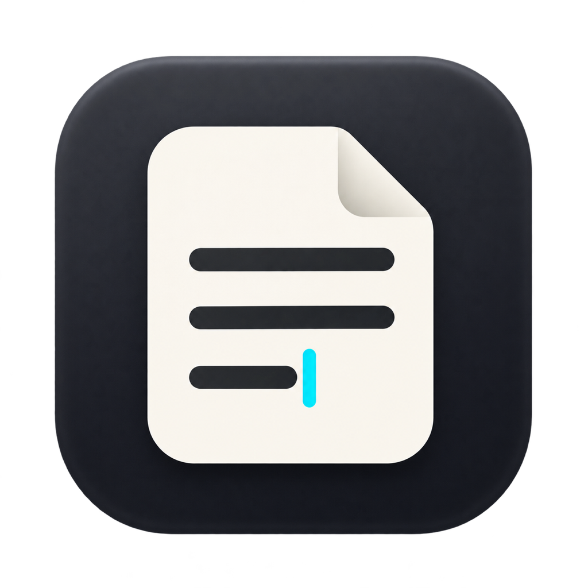

# Texted

<p align="center"></p>

[Download for macOS](https://github.com/dmytro-yemelianov/texted/releases) · [Build status](https://github.com/dmytro-yemelianov/texted/actions/workflows/build.yml) · [Packaging and releases](docs/releases.md)

A minimal Rust plain-text editor with a GPU-rendered GUI and a buffer owned by a separate server thread. The QNX, Ghostty and Zed references in the original design describe inspiration; they are not claims of equivalent architecture or measured display latency.

## Run

```sh
cargo run --release --bin texted -- path/to/file.txt
cargo run --release --bin texted
cargo run --release --bin texted-tui -- path/to/file.txt
# Require our own bitmap fonts through terminal graphics:
cargo run --release --bin texted-tui -- --render=kitty path/to/file.txt
# Or use the same executable:
cargo run --release --bin texted -- --terminal path/to/file.txt
```

The current GUI uses bundled bitmap fonts and macOS `pbcopy`/`pbpaste`. Running without a path opens an empty document. Open, Save As, overwrite and save-before-close use shared in-app dialogs in both the window and terminal modes. New and Open create tabs. Files can also be dropped onto the window, passed together on the command line, or opened together through Finder. Each tab retains its own buffer, undo/redo, selection, search and scroll position. Closing a changed tab prompts to save it. Quitting does not ask: every tab, with its unsaved text, caret line and encoding, is kept in `~/Library/Application Support/Texted/session/` (beside the preferences) and comes back at the next start; files named at launch open as extra tabs. Closing the last tab starts the next session empty. A second running Texted and the terminal mode keep no session; their Quit checks each changed tab and Cancel stops the sequence. When Texted regains focus or switches tabs it checks the file on disk: a document without unsaved changes rereads a newer version and keeps the caret line; a document with changes is kept and noted. Saving over a version another program wrote asks first: Overwrite, Reload or Cancel.

Terminal rendering defaults to Auto: supporting terminals receive pixel graphics with Texted’s own bitmap fonts, zoom and Appearance; other terminals receive ANSI characters. Use `--render=kitty` or `--render=ansi` to require either mode. See [terminal graphics, controls and limits](docs/terminal-graphics.md).

## Implementation

- `texted-buffer`: persistent Ropey tree, indexed byte/character/line conversions, immutable shared snapshots, bounded undo/redo (1,000 transactions), and grouped consecutive character input. Block operations and replacements are individual transactions.
- `texted-kernel`: reusable typed request/reply and notification primitives, retained for their tests and benchmarks. The GUI uses the bounded asynchronous `buffer_service` instead of blocking RPC.
- `texted-layout`: reads only visible rope slices; wrapping, caret placement, hit-testing, and highlight clipping share the same visual-row geometry. The viewport stores a physical top line and a wrapped subrow, so scrolling does not reflow preceding document lines.
- `texted-io`: streaming loading of UTF-8, UTF-16 (with a byte-order mark), Windows-1251 and KOI8-U, internal LF normalization, BOM/newline metadata, and buffered atomic saves through a unique sibling file. Files that are not UTF-8 are read as Windows-1251 or KOI8-U, whichever gives mostly lowercase Cyrillic; files with NUL bytes are refused as binary. Saves keep the file's encoding and stop, leaving the file untouched, at the first character it cannot hold. Mixed line endings and CR+CRLF sequences load verbatim so they save back unchanged. Saving through a symlink writes its target. Saves flush and sync the file and, on Unix, its parent directory. Existing permissions are preserved.
- `texted-app`: winit/wgpu shell using Metal on macOS. `graphics.rs` builds ordered drawing commands; `gpu.rs` draws instanced rectangles and glyphs from a bounded texture atlas. Search has one active job, one latest pending job and a bounded result mailbox; it counts matches without storing every offset. Bulk edits and replacements prepare snapshot plans outside the buffer owner and commit only against the same document, revision, cursor and selection. Shared dialogs return asynchronous tickets; file loading and saving run in background workers. The saved rope root tracks unsaved edits, including undo back to the saved state.

Snapshots do not flatten the document. Search streams across rope chunks. Text compositing, backgrounds, selection and the caret render on the GPU. Native one-bit glyph masks are unpacked on CPU cache misses and uploaded once per atlas entry. Atlas coverage is limited to eight 1 MiB pages, with eviction between frames; instance buffers are reused. There is no full-window CPU pixel buffer. The window backend requires a Metal-capable Mac; the terminal backend creates no window or GPU. See [shared cell-grid transport and terminal controls](docs/terminal-cell-grid.md).

## Controls

Development builds include native **Texted / File / Edit / Search / View / Window** menus. Right-click the document, or press **Shift+F10**, for editing and Style actions, including Duplicate line, Trim trailing spaces (spaces and tabs only; a raw `\r` is kept) and Go to line. Right-clicking inside a selection preserves it; clicking outside positions the caret first. Unavailable actions are disabled, and View options reflect the current editor state. Native Window actions include minimize, zoom and fullscreen. The published v0.2.0 preview predates these menus.

| Action | Shortcut |
|---|---|
| Copy / cut / paste | Cmd+C / Cmd+X / Cmd+V |
| Undo / redo | Cmd+Z / Cmd+Shift+Z |
| New / open | Cmd+N / Cmd+O |
| Save | Cmd+S |
| Save As | Cmd+Shift+S |
| Close / quit | Cmd+W / Cmd+Q |
| Find / replace | Cmd+F / Cmd+R |
| Next / previous match | Cmd+G / Cmd+Shift+G |
| Toggle wrapping | Option+Z |
| Horizontal scrolling (wrap off) | Trackpad / Shift+wheel / scrollbar |
| Block selection | Option+drag or Cmd+B |
| Toggle line numbers | Cmd+L |
| Duplicate line(s) | Cmd+Shift+D |
| Move line(s) up / down | Cmd+Option+Up / Down |
| Go to line (`:line` or `:line:column`, Enter) | Cmd+J |
| Appearance / styles | Cmd+, or F9 |
| Context menu | Right-click / Shift+F10 |
| Text scale, steps of 10% | Cmd++ / Cmd+- / Cmd+0 (100%) |
| Previous / next tab | Ctrl+Shift+Tab / Ctrl+Tab; Cmd+Shift+[ / ] |
| Document details | Cmd+Shift+I |
| Show / hide F-key panel | F1; View → Function Key Commands |
| Diagnostics | View → Diagnostics |

Physical letter keys keep shortcuts working with Ukrainian keyboard layouts. Wrapping breaks rows after spaces; a word longer than a row is split at the edge, and lines over 64 Ki characters wrap at character cells so deep scrolling stays cheap. Text uses character columns rather than grapheme clusters or shaped display cells; complex-script shaping and IME composition remain future work. No-wrap mode supports the trackpad horizontal axis, Shift+wheel, scrollbar dragging and page clicks. Navigation and typing keep the caret visible; manual scrolling leaves its document position unchanged.

The bottom of the window has one command-button row. There is no separate status strip. Hold **Control** to reveal scale and document values in the existing F-key cells:

| Ctrl layer | Button value and action |
|---|---|
| F7 / F8 | Decrease / increase text scale by 10% |
| F9 | Current scale, e.g. `110%`; click or press to reset to 100% |
| F10 | Cursor line:column; open document details |
| F11 | Wrapping state; click or press to toggle |
| F12 | Word count, or selected characters/rectangle size; open document details |

Buttons highlight on hover and briefly when invoked by mouse or keyboard. Hover help describes the current action and full values. Details show Unicode character count, normalized UTF-8 bytes and newlines, plus switches for the save encoding (UTF-8, UTF-8 with BOM, UTF-16 LE/BE, Windows-1251, KOI8-U), rereading the file in another encoding, and wrapping. A changed save encoding counts as an unsaved change. Word counts run on cancellable background snapshots; bytes exclude the BOM and use internal LF, so they can differ from saved file size.

The one-line panel can be hidden with F1. F-keys work while hidden: **F2 Save · F3 Find · F4 Replace · F5 Open · F6 New · F7 Previous tab · F8 Next tab · F9 Appearance · F10 Close tab · F11 Wrap · F12 Details**. Labels adapt to editor, search and Appearance context. While searching, F5 switches case matching (**Case** must match, **NoCs** ignores it, including Cyrillic capitals) and F6 switches whole words (**Word** only, **Part** also inside words); Replace and Replace All follow the same rules. Narrow framebuffers prioritize the active task; the Ctrl layer keeps zoom and counts visible. Hold **Cmd / Option / Control / Shift** on the keyboard for alternate actions; no modifier controls are drawn. Shift offers Save As, previous match and Replace All; Cmd exposes undo/redo, quit and diagnostics; Option exposes clipboard and selection actions. Shift+F10 retains the context menu. On keyboards reserving F-keys for media, use Fn or click the buttons while holding the modifier.

## Themes and typography

Available in `main` development builds; the published v0.2.0 preview predates this feature.

Appearance offers Modern Dark/Light, VGA, EGA, Atari, Commander, C64, ZX Spectrum, Amber and Green CRT palettes. The theme applies to the document, selection/search highlights, gutter, status, search and appearance panels. Palettes and editor fonts are independent.

Open **Appearance** with **F9** or **Cmd+,**. Drag its title to move it. Click a field to open its list, or use Tab/Shift+Tab then Enter/Space. Up/Down, Home/End and Page Up/Down preview the highlighted value immediately; Enter or a click keeps it, and Escape/outside clicks restore the previous value. Preview settings are not written to disk. Done keeps the preview and closes the panel. Font lists contain actual bitmap specimens and accept typed name searches; wheel scrolling browses long lists.

Five embedded faces include the complete Ukrainian alphabet: IBM BIOS 8×8, EGA 8×14, VGA 8×16, Spleen 6×12 and 8×16. The optional [Verba library bridge](docs/verba-font-library.md) adds the complete local catalog and saved glyph edits with actual coverage, disabled reasons and source metadata. It currently exposes 2,266 entries, of which 1,993 have unambiguous Unicode bitmap glyphs. The font selector does not invent Unicode mappings for raw-code fonts.

Text scale changes by **10%**, from 10–800%; 110%, 120%, etc. scale the original masks through nearest-texel sampling. The native glyph pixels stay one-bit. Legacy integer `size_px` settings still load. Line height is independently adjustable from 100–180%. UI labels use fixed bitmap faces. Unsupported characters display a missing-glyph box. See the [bundled font review](docs/bitmap-font-review.md). Appearance settings do not edit document text or undo history.

The Mouse cursor selector offers **System**, **Small pixel**, **Pixel**, **Large pixel**, **Dark pixel**, **Amber pixel**, **Green pixel**, **Cyan pixel**, **Classic arrow**, **Crosshair** and **Ring**. Pointer shapes follow the hovered control: text, buttons and draggable headers. Reticles retain text and drag-specific shapes. Pixel cursor sizes are bounded inside limited-resolution framebuffers. Custom cursors render within the app; the system cursor returns outside the client scene, on focus loss and during file dialogs.

Style also offers a **Screen / Resolution** row. **Auto (theme)** renders retro palettes into a real limited-resolution framebuffer: VGA 640×480, EGA 640×350, Atari/C64 320×200, Commander 720×400, ZX Spectrum 256×192, and monochrome 720×350. Modern themes stay native. Choose **Native** for a full-resolution palette, or select an explicit raster independently of the theme. The complete in-app scene scales to the largest size that fits the window, preserving the source aspect ratio with letterboxing and nearest-texel sampling. Fractional upscale factors are supported. Compact Style/search/status controls remain usable at 256×192. Native and framebuffer typography are saved separately; framebuffers start with IBM BIOS 8×8 at 8 px. See [framebuffer behavior and reference platforms](docs/framebuffer.md).

Preferences save atomically in the background to `~/Library/Application Support/Texted/appearance.json`. The latest accepted settings are flushed on normal exit. An invalid or newer-version file is left intact; the app uses session-only defaults and reports the load error. `TEXTED_SETTINGS_PATH` selects an alternate file for isolated previews.

For custom colors, edit that file while Texted is closed; for example:

```json
{
  "version": 1,
  "theme": "c64",
  "framebuffer": "auto",
  "pixel_typography": { "family": "bios_8x8", "size_px": 8, "line_spacing": 100 },
  "typography": { "family": "spleen_8x16", "size_px": 16, "line_spacing": 120 },
  "colors": { "text": "#E8DCFF", "selection": "#6454A0" }
}
```

Optional `colors` keys are `bg`, `text`, `caret`, `selection`, `block_selection`, `search_match`, `search_active`, `gutter_bg`, `gutter_border`, `gutter_text`, `panel_bg`, `panel_border`, `input_bg`, `input_border`, `input_active`, `button_bg`, `button_border`, `status_bg`, `status_border`, `status_text`, and `status_accent`. Values must be `#RRGGBB`; unknown keys are rejected. Selecting another palette clears color overrides; typography changes retain them. Reset defaults restores the built-in appearance. All five faces are embedded in the executable. Older `courier`, `menlo`, `monaco` and `pixel` preferences migrate to bitmap faces with valid native sizes. Fixed framebuffers use a nearest-texel presentation pass. CRT effects remain a separate future change.

## Validation

```sh
cargo fmt --all -- --check
cargo clippy --workspace --all-targets -- -D warnings
cargo test --workspace
# Hardware rendering test, explicitly run on a Mac with a Metal GPU:
cargo test -p texted-app metal_ -- --ignored --nocapture
cargo run --release --bin bench
cargo run --release --bin bench -- --hardening
```

The benchmark reports CPU operation times and percentiles, never keyboard-to-pixel latency. View → Diagnostics reports UI command preparation time, layout time, document bytes, snapshot storage type and the active GPU/backend. These CPU times exclude GPU execution, submission and display scanout; the HUD does not report display FPS or RAM usage.

See [performance notes](docs/performance.md) for the audit, measurements and remaining limits. [The original design](docs/design-spec.md) is historical planning material.

The [hardening results](docs/performance-hardening-results.md) record implementation, benchmarks and acceptance evidence for the [specification](docs/performance-hardening-spec.md) and [staged plan](docs/performance-hardening-plan.md).

`main.rs` bootstraps the app; `app.rs` adapts native events. `input`/`commands` decode intents, `editing`/`selection` own canonical transitions, `search` owns bounded scan jobs, and `editor_view` paints immutable snapshots. `file_flow` and `transfers` enforce save/close and clipboard barriers. Redraw never waits for a buffer reply.

Search queries are limited to 64 KiB and auxiliary search storage to 8 MiB. Generated edit growth and clipboard text are limited to 128 MiB. The buffer accepts at most 64 undrained commands; saturation is visible in the window title. Clipboard operations have a five-second deadline. Escape cancels pending bulk/clipboard work. New edits can invalidate a worker plan; its conflict is shown without overwriting the newer content. Save, New, Open and Close wait for earlier accepted mutations and clipboard continuations.
