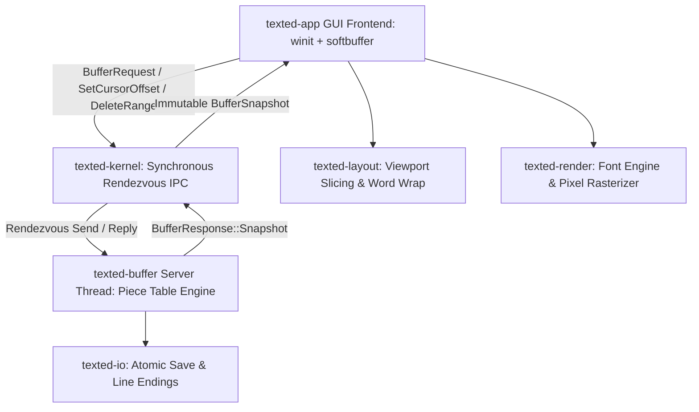
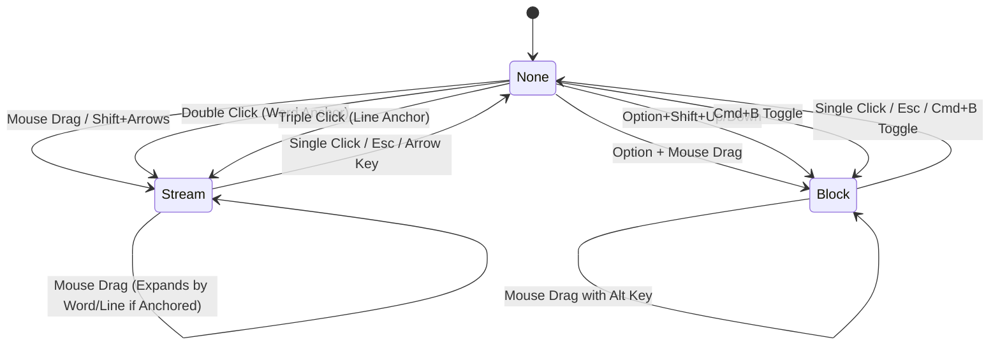

> Updated 2026-11-05: the implementation changed substantially after this handover. Start with [README](README.md) and [audit follow-up](docs/performance.md). The Piece Table, renderer crate and diagnostics descriptions below are historical.

# Texted — Agent Handover Document

> [!NOTE]
> This document serves as a complete briefing and architectural reference for any AI agent or developer continuing work on **Texted**. It outlines the project vision, microkernel architecture, recent implementations, test suite, and upcoming milestones.

---

## 1. Project Overview & Philosophy

**Texted** is an ultra-fast, minimal, crash-resilient text editor written in **Rust**, inspired by the microkernel architecture of **QNX**. Unlike traditional monolithic text editors where UI, document buffers, and layout engines share direct memory and thread execution, Texted isolates its core buffer engine in an independent server thread communicating strictly via synchronous rendezvous IPC and priority pulses.



### Key Core Invariants
1. **Microkernel Decoupling**: The GUI thread never mutates buffer state directly; it dispatches `BufferRequest` messages or priority `Pulse` signals across `ChannelClient` to the `TextBuffer` server thread.
2. **Deterministic Immutability**: Rendering and layout calculations operate strictly on immutable `BufferSnapshot` instances taken per frame.
3. **Zero Layout Interference**: Cursor navigation, mouse selections, gutter widths, and status bars are mathematically bounded so that extreme scales (e.g. 3,000,000+ lines, 200MB+ documents) never overflow or corrupt visual alignment.

---

## 2. Workspace Crate Architecture

The workspace is structured into six modular crates:

| Crate | Responsibility | Key Symbols / Modules |
| :--- | :--- | :--- |
| [crates/texted-kernel](crates/texted-kernel) | Synchronous IPC rendezvous, priority pulses, channel pairs. | `ChannelPair`, `ChannelServer`, `ChannelClient`, `Pulse`, `PULSE_KEY_INPUT` |
| [crates/texted-buffer](crates/texted-buffer) | Piece Table document model, UTF-8 char/byte offsets, block operations, search & replace. | `TextBuffer`, `BufferSnapshot`, `BufferRequest`, `BufferResponse`, `Piece` |
| [crates/texted-layout](crates/texted-layout) | Viewport geometry, visible line slicing, word wrapping, continuation rows. | `LayoutEngine`, `ViewportConfig`, `ViewportLayout`, `VisibleLine`, `Rect` |
| [crates/texted-render](crates/texted-render) | Software rasterizer, glyph batcher, Ukrainian TTF antialiasing. | `RenderBatcher`, `Quad`, `FontEngine`, `softbuffer` integration |
| [crates/texted-io](crates/texted-io) | Atomic file persistence (write-temp-and-rename), newline detection. | `IoManager`, `LineEnding` (LF/CRLF), `IoError` |
| [crates/texted-app](crates/texted-app) | Main GUI executable, event loop, mouse/keyboard state machine, diagnostics HUD. | [main.rs](crates/texted-app/src/main.rs), [bench.rs](crates/texted-app/src/bin/bench.rs), `SelectionState` |

---

## 3. Key Subsystems & State Machines

### A. Selection State Machine
The editor supports two primary selection paradigms:
1. **Stream Selection (`SelectionMode::Stream`)**: Linear character stream selection across lines.
2. **Column / Block Selection (`SelectionMode::Block`)**: Rectangular column selection across rows, triggered via `Option + Mouse Drag`, `Cmd + B`, or `Option + Shift + Up/Down`.



### B. Trackpad Micro-Jitter Immunity & Word/Line Anchoring
- **Problem**: On macOS trackpads, clicking down emits tiny subpixel `CursorMoved` events before the click is released. Previously, `CursorMoved` unconditionally overwrote `selection.active_col` with `hover_col`, causing double-clicked words or triple-clicked lines to truncate to the exact cursor coordinate.
- **Solution**:
  - `word_drag_anchor: Option<(usize, usize, usize)>` stores `(click_line, w_start, w_end)`.
  - `line_drag_anchor: Option<usize>` stores `click_line`.
  - Inside `find_word_boundaries(line_str, col)`, word boundaries are classified across alphanumeric characters + `_`, whitespace runs, or punctuation blocks.
  - While dragging, if the pointer stays within the anchor word/line, the full anchor remains selected. If the pointer moves outside, selection expands discretely by whole words or whole lines.

### C. Dynamic Gutter & Right-Aligned Line Numbers
- **Problem**: In files with >1,000,000 lines, fixed 58px gutters caused 7-digit line numbers (`3125711`) to spill over the gutter border and overwrite buffer text.
- **Solution**:
  - `compute_gutter_metrics(total_lines, show_line_numbers, char_w)` calculates:
    - `digits = total_lines.max(1).to_string().len().max(3);`
    - `gutter_w = 10.0 + (digits * char_w) + 10.0;`
    - `text_start_x = gutter_w + 8.0;`
  - Line numbers are formatted right-aligned via `format!("{:>width$}", line_idx + 1, width = line_digits)` and rendered with a 10px left pad.
  - Viewport layout, caret position, mouse click detection, search highlights, and selection rendering are strictly anchored to `text_start_x`.

### D. Keyboard Layout Independence
- Physical keys are evaluated via `KeyCode` first (e.g. `KeyCode::KeyC`, `KeyCode::KeyV`, `KeyCode::KeyZ`, `KeyCode::KeyA`, `KeyCode::KeyF`, etc.) with fallback to character checking.
- All shortcuts (`Cmd+C`, `Cmd+V`, `Cmd+Z`, `Cmd+Shift+Z`, `Cmd+S`, `Cmd+A`, `Cmd+F`, `Cmd+R`, `Cmd+G`, `Cmd+B`, `Cmd+L`, `Alt+Z`) operate independently of the selected system input language (Ukrainian, English, etc.).

---

## 4. Diagnostics & Benchmark Suite

### A. Real-Time HUD (`F3`)
Pressing `F3` in the GUI activates a translucent diagnostics overlay in the upper-right corner:
- **FPS**: Real-time rendering frame rate.
- **Frame time**: Total frame elapsed time in milliseconds.
- **Layout time**: Viewport calculation latency in microseconds.
- **Doc bytes**: Exact document payload size in bytes.
- **RAM footprint**: Process memory baseline.

### B. Benchmark Binary (`bench.rs`)
Located in [crates/texted-app/src/bin/bench.rs](crates/texted-app/src/bin/bench.rs), this tool tests:
1. **IPC Rendezvous Latency**: Roundtrip messaging between client and server threads.
2. **Piece Table Insertions**: Insertion speed at various buffer offsets.
3. **Viewport Layout Computation**: Latency of `LayoutEngine::compute_layout` with and without Word Wrap across small and large documents.

To run benchmarks:
```bash
cargo run --release --bin bench
```

---

## 5. Development & Testing Commands

### Build & Check
```bash
# Type check all crates and benchmarks
cargo check --all-targets

# Run the complete test suite (11 unit tests across crates)
cargo test --workspace

# Build the release binary
cargo build --release
```

### Running the Editor
```bash
# Launch without file (opens empty document)
./target/release/texted

# Launch with a specific file
./target/release/texted path/to/document.txt
```

---

## 6. Recommended Next Steps for the Next Agent

> [!TIP]
> The following areas are high-value improvements planned for upcoming iterations:

1. **Syntax Highlighting Engine**:
   - Integrate Tree-sitter or syntect into a dedicated highlighting server crate (`texted-syntax`) via asynchronous snapshot queries.
2. **Memory-Mapped Large File Support**:
   - For files >500MB, implement memory-mapped read-only pieces in `TextBuffer` to eliminate holding the entire raw string in RAM.
3. **Multi-Tab / Multi-Buffer Session Support**:
   - Introduce a tab bar interface or buffer switcher (`Cmd+P` / `Cmd+O`) supported by multiple `ChannelClient` sessions.
4. **Horizontal Scroll Bar (No-Wrap Mode)**:
   - When Word Wrap is disabled (`Alt+Z`), implement horizontal panning and scroll tracking.
