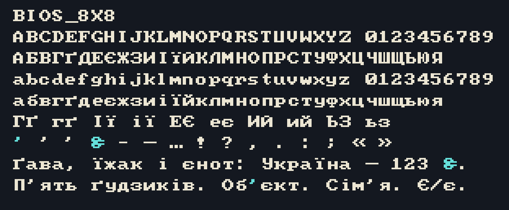
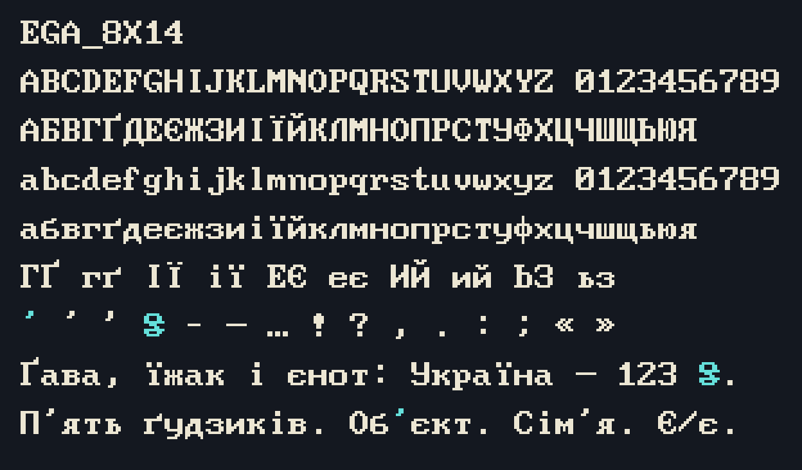
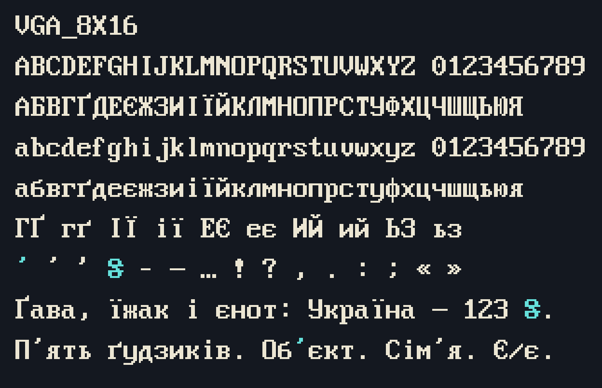
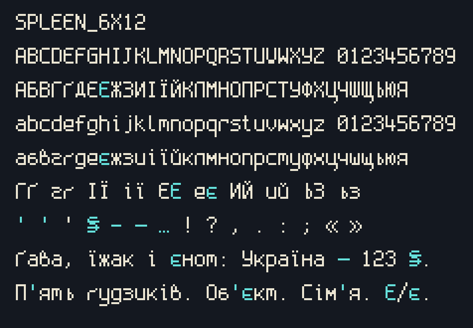
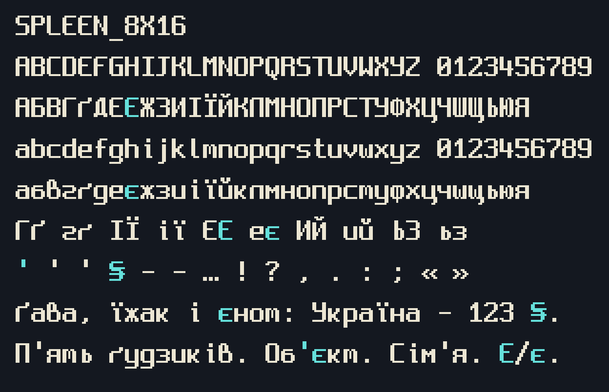

# Ukrainian bitmap font review

Texted now renders document text and its custom UI with bundled, native bitmap
strikes. Outline rasterization, thresholded system-font fallback, system-font
loading, `ab_glyph` and the incomplete `font8x8` dependency are removed. The
Metal renderer and framebuffer presentation continue to use nearest-texel
sampling. Font sizes are integer multiples of native height; line spacing adds
whole empty scanlines. Characters outside a face's repertoire show a visible
missing-character box. Document bytes are independent of font selection.

## Catalog audit and selection

The local Nasinnia catalog was reviewed at commit
`fdd545febf4a23048b4d5927c1f70fd649c845c8`. Coverage includes all 33 Ukrainian
letters in both cases, plus `ʼ ’ ' ₴ – — …`. Metadata entries without native
rasters are not usable font sources.

| Candidate | Findings | Decision |
|---|---|---|
| font8x8 Basic | No Cyrillic; system-font replacement was inconsistent with the Latin pixels | Remove |
| Nasinnia's CP437 PC strikes | No Ukrainian Cyrillic | Use the same pack's Unicode Plus bitmap variants for BIOS/EGA/VGA |
| Spleen 6×12 / 8×16 | Native Cyrillic, missing Є/є and some Ukrainian punctuation/currency | Preserve existing masks and add missing glyphs |
| Spleen 5×8 | No Cyrillic | Defer |
| Spleen 12×24 / 16×32 | Larger source cells, also missing Є/є | Defer; selected strikes already support integer enlargement |
| Creep | Catalog strike is 7×12, lacks Cyrillic | Defer |
| Cozette | Covers Ukrainian, but the normalized catalog has a 13×15 global cell despite its 6×13 label | Defer pending explicit per-glyph bearing/advance handling |
| Hoard metadata | Inventory records do not establish eligible native raster data and redistribution rights | Do not bundle |

The related `pixel-ssh` implementation provided a useful cross-check: its IBM
Cyrillic masks come from the same pinned native Unicode Plus sources, without
squeezing system outlines into small cells. The official
[Oldschool PC Font Pack documentation](https://int10h.org/oldschool-pc-fonts/readme/)
describes the Unicode Plus extensions. The original archive is pinned by
SHA-256 in [sources.json](../assets/fonts/sources.json).

## Shipped strikes

| Face | Native cell | Baseline from cell top | Available heights | License |
|---|---|---|---|---|
| IBM BIOS | 8×8 | 7 | 8, 16, 24, 32, 40, 48, 56, 64 | CC BY-SA 4.0 |
| IBM EGA | 8×14 | 11 | 14, 28, 42, 56 | CC BY-SA 4.0 |
| IBM VGA | 8×16 | 12 | 16, 32, 48, 64 | CC BY-SA 4.0 |
| Spleen Small | 6×12 | 9 | 12, 24, 36, 48, 60 | BSD 2-Clause |
| Spleen | 8×16 | 12 | 16, 32, 48, 64 | BSD 2-Clause |

Defaults are VGA 8×16 at native height for Native screens and BIOS 8×8 for fixed
framebuffers. Custom UI labels use those respective faces independently of
editor zoom. Existing version-1 settings migrate `courier` → VGA, `menlo` →
Spleen 8×16, `monaco` → Spleen 6×12 and `pixel` → BIOS. Heights round to the
nearest supported integer scale. Cmd+0 resets to the selected face's native
height. Names, valid sizes and dropdown choices no longer depend on installed
macOS fonts.

## Glyph adaptations

All native glyphs are preserved byte for byte. The IBM Unicode Plus strikes
already contain the full Ukrainian alphabet. Spleen's Є/є mirror the ink of its
own Э/э within the same bearings: this retains baseline, stroke weight,
corner treatment and cell width. Existing Г/Ґ, І/Ї, И/Й and Ь/З remain distinct.

Only absent glyphs are added. Modifier apostrophe ʼ uses the face's native
apostrophe; absent right apostrophes use its ASCII apostrophe. Dashes extend
the native hyphen at the same scanlines; ellipsis repeats three native dots at
their original baseline. Hryvnia uses the face's S with two full-cell currency
bars, extending into the side bearing so they remain distinct from S/8 at low
resolution. An outlined missing-character box is added where necessary.
Exact recipes and rows are recorded in
[ukrainian-additions.json](../assets/fonts/ukrainian-additions.json).

Review sheets below enlarge the actual shipped mask pixels by 4× without
interpolation. Added glyphs are cyan; original glyphs are cream. They include
both alphabets, confusing pairs, punctuation and Ukrainian sentences.







## Reproduction and validation

Font assets are compiled into the executable. Packages also include unchanged
sources, generated masks, pins, modification records, attribution and full
license texts. See [NOTICE](../assets/fonts/NOTICE.md). Rendering has no runtime
font dependency and performs no outline resampling.

```sh
# Optional offline authoring decoder: fonttools==4.60.2
python3 scripts/build_bitmap_fonts.py --check
# Optional review-sheet generation: Pillow==11.2.1
python3 scripts/review_bitmap_fonts.py
# Ordinary CI requires neither dependency
python3 -m unittest discover -s scripts -p 'test_*.py'
cargo test --locked --workspace
cargo test --release -p texted-app --bin texted metal_ -- --ignored
```

Asset checks pin source/output hashes, sorted scalar records, native row bounds,
full Ukrainian coverage, every documented addition and preservation of original
glyph rows. Rust checks exercise every Ukrainian glyph at every supported scale,
binary coverage, shared caret/hit geometry and legacy preference migration.
The Metal readback check rejects any intermediate edge colors and verifies
clipping, paint order and exact framebuffer texels. Packaging verifies the full
font source/license tree both before archiving and after ZIP restoration.

This is scalar-cell rendering. Decomposed sequences, grapheme shaping and IME
composition remain outside this change; this work does not normalize document
text or silently replace unsupported scalars with another font.
